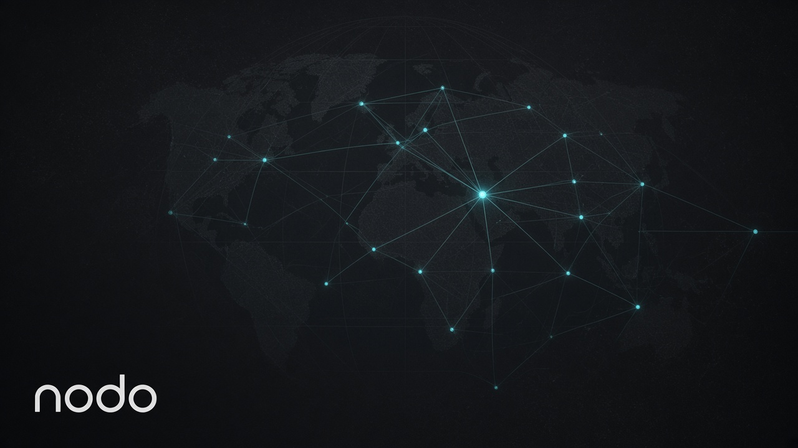

# Luiz Eduardo

### Inference on the machines you already own

Paying an API for every token is expensive. Running a full model on one box is too heavy. I build the path between those two: tools that talk to *your* endpoint, and one model split across the computers you already have.

São Paulo, Brazil

  

## [nodo](https://github.com/LuizEduPP/nodo) — several computers, one model

Each disk keeps the part it created. A prompt walks the machines that are up: `embed → banks → head`. Weights do not travel.

Protocol `nodo/1`. In test. Everyone can contribute.

**[Open nodo →](https://github.com/LuizEduPP/nodo)**

## What I ship

| | |
| --- | --- |
| **[Rememb](https://github.com/LuizEduPP/Rememb)** | Agents forget. Rememb does not. Local file, MCP, zero config. Cursor, Windsurf, Claude. |
| **[Solid](https://github.com/LuizEduPP/solid)** | Research that scores its own evidence before it trusts a source. |
| **[NeuraEdge](https://github.com/LuizEduPP/NeuraEdge)** | Drop a note. Watch it become a neuron. Local PKM as a 3D brain. |
| **[Toole](https://github.com/LuizEduPP/Toole)** | Chat that can use tools, in the Chrome side panel, on the model you run. |
| **[Citepane](https://github.com/LuizEduPP/Citepane)** | Select text. Get a grounded answer. Your model, your endpoint. |
| **[Companion](https://github.com/LuizEduPP/Companion)** | A presence on the desktop. Watches the machine. Speaks when it matters. |

Also: [Cats Shields](https://github.com/LuizEduPP/cats-shields) blocks images by keyword. [Esp Projects](https://github.com/LuizEduPP/esp-projects) is firmware for ESP boards.

Want a machine on the mesh, a local stack, or someone who ships this class of product?

**[luizedupp@gmail.com](mailto:luizedupp@gmail.com)** · **[LinkedIn](https://www.linkedin.com/in/luizedupp)**

